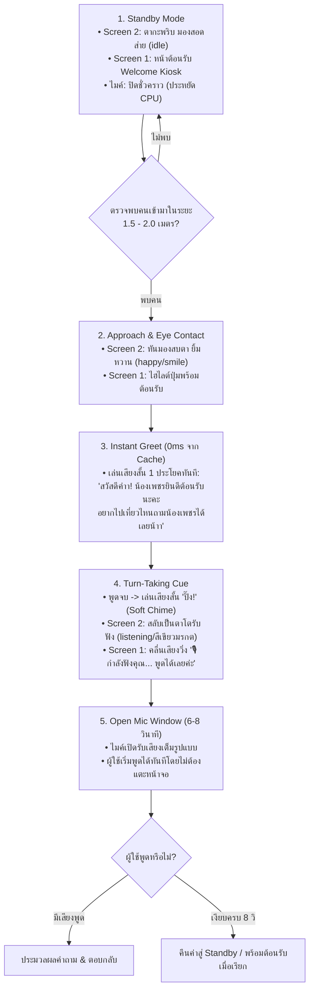

# แผนสถาปัตยกรรมระบบการสนทนาโต้ตอบและป้องกันเสียงชนกัน
## (Voice Turn-Taking, Anti-Collision & Zero-Perceived Latency Architecture)
### โครงการ: น้องเพชร AI Smart Guide — วิทยาลัยอาชีวศึกษาเพชรบุรี (PBVC)

---

## 1. บทนำและปัญหาสำคัญ (Problem Statement)

ในการพัฒนาระบบผู้ช่วยอัจฉริยะแบบ Kiosk และหุ่นยนต์ปฏิสัมพันธ์ทางกายภาพ (Human-Robot Interaction) ปัญหาที่มักทำให้ประสบการณ์ผู้ใช้สะดุดและรู้สึกว่า "ยังเป็นหุ่นยนต์แข็งทื่อ" มี 2 ปัจจัยหลัก:

```
[ปัญหาที่ 1: ความหน่วงของเสียง (TTS Latency)]
ผู้ใช้ถามคำถาม ──► AI ประมวลผล (0.5s) ──► รอสังเคราะห์เสียง TTS (2-3s) ──► เกิดความเงียบ (Dead Air) น่าอึดอัด

[ปัญหาที่ 2: เสียงชนกันและเสียงสะท้อน (Acoustic Collision & Echo)]
ลำโพงบอทส่งเสียง ──► ไมโครโฟนดูดเสียงลำโพงเข้าตัวเอง ──► STT แปลงเสียงตัวเอง ──► บอทตอบตัวเองวนลูป (Self-Echo)
ผู้ใช้พูดแทรก ──► บอทไม่หยุดพูด ──► เสียงคนกับเสียงบอทตีกันจนฟังไม่รู้เรื่อง
```

เอกสารฉบับนี้กำหนดพิมพ์เขียวทางวิศวกรรม (Engineering Blueprint) ทั้งในระดับ **ซอฟต์แวร์ (Software Flow)**, **จังหวะจะโคน (Turn-Taking Cues)** และ **การประมวลผลเสียง (Audio Engineering)** เพื่อให้ระบบเปิดขึ้นมาแล้วพร้อมสนทนาได้ทันทีอย่างราบรื่น 100%

---

## 2. แผนผังโฟลว์การเปิดระบบ (Opening Interaction Flows)

เพื่อความยืดหยุ่นในการใช้งานจริงในบริบทต่าง ๆ ได้จำลองรูปแบบโฟลว์การเริ่มต้นสนทนาไว้ **3 รูปแบบ**:

### 🌟 รูปแบบ A: "Proactive Smart Host" (แนะนำสูงสุดสำหรับ Kiosk / งานนิทรรศการ)
*น้องเพชรทำหน้าที่เป็นเจ้าบ้านตัวจริง ทักทายก่อนเมื่อคนเดินเข้ามา แล้วเปิดไมค์รอฟังทันทีโดยไม่ต้องสัมผัสจอ (Hands-Free)*



---

### 🎙️ รูปแบบ B: "Always-On Wake-Word" (สไตล์ Siri / Google Assistant)
*เหมาะสำหรับพื้นที่เปิดโล่งที่มีเสียงรบกวนรอบข้างสูง เพื่อไม่ให้น้องเพชรทักคนที่แค่เดินผ่าน*
- **ไมค์เปิดสแตนด์บายตลอดเวลา** ดักฟังเฉพาะคำว่า `"น้องเพชร"` หรือ `"พี่เพชร"`
- เมื่อผู้ใช้พูดว่า *"น้องเพชร..."*
  1. น้องเพชรขานรับทันทีจากไฟล์เสียงแคช: *"ค่ะ! น้องเพชรฟังอยู่ค่า มีอะไรให้ช่วยมั้ยคะ? ✨"*
  2. จอ Screen 2 สลับเป็นโหมด `listening`
  3. ผู้ใช้เอ่ยคำถามต่อได้ทันที

---

### 👋 รูปแบบ C: "Wave & Eye-Contact Hold" (สบตา 1.5 วินาที หรือยกมือทักทาย)
*ใช้กล้อง AI ตรวจจับเจตนาที่แท้จริงของผู้ใช้ (Intent-Driven Trigger)*
- หากคนเดินผ่านเร็ว ๆ จะไม่ทัก
- แต่ถ้า **"ยืนหยุดมองสบตากล้องเกิน 1.5 วินาที"** หรือ **"ยกมือบ๊ายบายให้กล้อง"**
- น้องเพชรจะอุทานด้วยความสดใส *"ว้าวว สวัสดีค่ะ!"* แล้วเปิดไมค์รอฟังคำถามทันที

---

### ตารางเปรียบเทียบข้อดี-ข้อจำกัดของแต่ละรูปแบบ

| รูปแบบ | ข้อดีเด่น | ข้อควรระวัง | สถานการณ์ที่เหมาะสมที่สุด |
| :--- | :--- | :--- | :--- |
| **A. Proactive Host** *(แนะนำ)* | • ผู้ใช้ไม่ต้องมีทักษะเทคโนโลยี แค่เดินเข้ามาก็คุยได้ทันที<br/>• ดูมีชีวิตชีวา ดึงดูดสายตาผู้เข้าชมนิทรรศการ | • หากคนยืนมุงหลายคน ต้องมีระบบ Session Lock เพื่อไม่ให้ทักซ้ำ | • จุดต้อนรับหน้าตึกอำนวยการ<br/>• บูธจัดแสดงนวัตกรรมสิ่งประดิษฐ์ |
| **B. Wake-Word** | • แม่นยำ ไม่เปิดไมค์มั่วซั่วเมื่อมีคนเดินผ่าน | • ผู้ใช้ต้องรู้ล่วงหน้าว่าต้องเรียกชื่อ "น้องเพชร" | • โรงอาหาร หรือโถงที่มีเสียงจอแจ |
| **C. Wave & Gaze** | • ล้ำสมัย มีกิมมิคโชว์ความสามารถ Computer Vision | • ใช้พลังประมวลผลกล้อง AI ต่อเนื่อง | • การนำเสนอต่อหน้าคณะกรรมการ |

---

## 3. สถาปัตยกรรมป้องกันเสียงชนกัน (Anti-Collision & Turn-Taking)

เพื่อตัดปัญหา **เสียงสะท้อนเข้าไมค์ (Self-Echo)** และ **คนกับหุ่นยนต์พูดทับกัน** ระบบต้องใช้มาตรการ 4 ชั้น:

```
[ มนุษย์พูด ] ────────► ไมโครโฟนเปิด (Mic ON) ──► ลำโพงเงียบสนิท
                                                          │
                                                          ▼
[ บอทกำลังพูด ] ◄────── ไมโครโฟนปิดสนิท (Mic OFF) ◄── ลำโพงส่งเสียงพูด
                                                          │
                                                          ▼
[ บอทพูดจบ ] ─────► หน่วง 400ms (Acoustic Decay) ──► เสียง ปิ๊ง! ──► สลับเปิดไมค์ฟังต่อ
```

### 1. Software Half-Duplex Gate (Mute-on-Speak Gate)
- ทันทีที่คำตอบถูกส่งเข้าสู่ตัวเล่นเสียง ลำโพงจะเซ็ตแฟล็ก `isSpeakingTTS = true`
- **ระบบ STT (Speech Recognition) จะถูกสั่ง `stop()` หรือตัดทิ้งอินพุตทันที (Hardware/Software Mute)**
- ไมโครโฟนจะไม่บันทึกเสียงใดๆ ในช่วงที่ลำโพงกำลังขับเสียงพูดออกมา ป้องกันไม่ให้ไมค์รับเสียงตัวเองโดยเด็ดขาด

### 2. Acoustic Decay Cooldown (พักเสียงสะท้อน 400 - 600ms)
- เมื่อไฟล์เสียงพูดจบลง (`audio.onended`) เสียงจะยังสะท้อนอยู่ในห้องหรือในกรอบตู้ Kiosk อีกประมาณ 200 - 400ms
- หากเปิดไมค์ทันที ไมค์จะเก็บเสียงสะท้อนท้ายประโยค (เช่น "...ค่ะ", "...นะคะ") แล้วส่งไปคิดคำตอบใหม่
- **แนวทางแก้:** บังคับหน่วงเวลา `ACOUSTIC_COOLDOWN_MS = 500` มิลลิวินาทีหลังเสียงจบ ก่อนจะสั่งเปิดไมค์รับเสียงมนุษย์

### 3. Visual & Audio Turn-Taking Cues (บอกจังหวะให้มนุษย์เข้าใจ)
- สาเหตุหลักที่คนพูดแทรกบอท เพราะคนไม่รู้ว่าบอทพูดจบหรือยัง และไม่รู้ว่าบอทพร้อมฟังตอนไหน
- **สร้างสัญญาณสัมผัส 2 ทาง:**
  1. **Audio Cue:** เล่นเสียง Earcon นุ่มๆ สั้นๆ 0.2 วินาที (เช่น เสียง *ปิ๊ง!*) ในจังหวะที่เปิดไมค์
  2. **Visual Cue:** บนจอ Screen 2 เปลี่ยนตาทันทีจากตาพูด (^ ^) เป็นตาฟังสีเขียว (👂) พร้อมแสดงแอนิเมชันคลื่นเสียงขยับตามระดับเสียงจริง

### 4. Emergency Touch-to-Barge-In (ระบบแตะแทรก)
- หากน้องเพชรกำลังเล่าข้อมูลท่องเที่ยวยาวๆ แล้วผู้ใช้ต้องการเปลี่ยนเรื่อง:
- ผู้ใช้สามารถ **แตะหน้าจอสเตจหน้าตาน้องเพชร 1 ครั้ง** หรือแตะที่หน้าจอ Screen 1
- ระบบจะสั่ง `audio.pause(); audio.currentTime = 0;` ตัดจบเสียงทันที และเปิดไมค์รับฟังคำสั่งใหม่ทันทีโดยไม่ค้าง

---

## 4. กลยุทธ์แก้ปัญหา "โหลดเสียงนาน" (Zero-Perceived Latency)

การรอคอยสังเคราะห์เสียงใหม่ (TTS Synthesis) ประโยคยาว 3-4 ประโยค ใช้เวลาประมาณ 1.5 - 3 วินาที ทำให้เกิดความเงียบ (Dead Air) ที่ผู้ใช้รู้สึกว่าระบบหน่วง

### แผนภูมิเปรียบเทียบการตอบสนอง

```
แบบเดิม:
ผู้ใช้พูดจบ ──► [ เงียบสนิท 2.5 วินาที (Dead Air) ] ──► เริ่มเล่นเสียงประโยคยาว (ผู้ใช้รู้สึกว่าช้า)

แบบใหม่ (Zero-Perceived Latency):
ผู้ใช้พูดจบ ──► [ 0.1s เล่นเสียง Filler ทันที ] ──► [ ต่อด้วยประโยคหลักทันที ]
                "อื้อหืออ ได้เลยค่าา..."          "สำหรับพระนครคีรีหรือเขาวังนะคะ..."
                ▲                                ▲
                (เล่นไฟล์แคช 0ms ในเครื่อง)       (ระหว่างที่เสียงเกริ่นเล่น เสียงหลักก็เจนเสร็จพอดี!)
```

### กลยุทธ์ที่ 1: Instant Conversational Fillers (คำตอบรับทันที <100ms)
บันทึกไฟล์เสียงสั้น ๆ ของน้องเพชรไว้ล่วงหน้า (Pre-baked Fillers) เมื่อผู้ใช้ถามจบ ระบบจะสุ่มเสียงตอบรับมาเล่นทันทีก่อนที่ประโยคหลักจะประมวลผลเสร็จ:

| เจตนาคำถาม | ตัวอย่างเสียง Filler ที่เล่นทันที (0.1s) | อารมณ์ | ความยาวเสียง |
| :--- | :--- | :---: | :---: |
| **ท่องเที่ยว/ของกิน** | *"อื้อหืออ ได้เลยค่าา..."* / *"เรื่องเที่ยวไว้ใจน้องเพชรได้เลยค่ะ..."* | `excited` | ~1.2 วินาที |
| **ทั่วไป/ความรู้** | *"อ๋ออ เรื่องนี้นะคะ แป๊บนึงน้าา..."* / *"ได้เลยค่า น้องเพชรเช็คข้อมูลให้แป๊บนึงนะคะ"* | `thinking` | ~1.5 วินาที |
| **ความรัก/แซว/ให้กำลังใจ** | *"แหมมม..."* / *"โอ๋ๆ น้าา สู้ๆ นะคะคุณพี่..."* | `love`/`wink` | ~1.0 วินาที |

> **ผลลัพธ์:** ผู้ใช้จะได้รับเสียงตอบสนองในเสี้ยววินาที ไม่รู้สึกว่าต้องรอคอย และในระหว่างที่เสียงเกริ่นกำลังดังอยู่นั้น ระบบ TTS จะสร้างประโยคหลักเสร็จสมบูรณ์พอดี จึงเล่นต่อได้อย่างลื่นไหลไร้รอยต่อ

---

### กลยุทธ์ที่ 2: Chunked First-Sentence TTS
- แทนที่จะส่งข้อความทั้งย่อหน้า (150-200 ตัวอักษร) เข้าเครื่องสังเคราะห์เสียงพร้อมกัน
- ให้ตัดส่ง **เฉพาะประโยคแรก (30-40 ตัวอักษร)** เข้าไปก่อน ซึ่งใช้เวลาสังเคราะห์เพียง **~0.3 วินาที**
- เริ่มสตรีมเสียงประโยคแรกให้ผู้ใช้ฟังทันที ขณะที่ประโยคแรกกำลังเล่น ระบบจะประมวลผลประโยคที่สองและสามรอไว้ในคิว (Pipelined Synthesis)

---

### กลยุทธ์ที่ 3: Extended Pre-baked Audio Cache สำหรับคำตอบสำคัญ
ข้อความยอดนิยมที่มีการถามซ้ำบ่อย ๆ ควรทำการ Pre-bake สังเคราะห์เป็นไฟล์ `.mp3` คุณภาพสูงเก็บไว้ในไดเรกทอรี `static/audio/cache/` ถาวร:
1. คำทักทายต้อนรับทั้งหมด (Greetings 1-5)
2. ข้อมูลไฮไลท์ 3 วัง (เขาวัง, ถ้ำเขาหลวง, พระราชนิเวศน์มฤคทายวัน)
3. ข้อมูลอาหารขึ้นชื่อ (ขนมหม้อแกง, ก๋วยเตี๋ยวน้ำแดง, ข้าวแช่)
4. ข้อมูลการรับสมัครและ 9 สาขาวิชาชีพของ PBVC

---

## 5. ขั้นตอนการติดตั้งใช้งานจริง (Implementation Roadmap)

1. **ระดับ Audio Queue:**
   - เพิ่มฟังก์ชัน `playAudioChain([fillerAudio, mainAudio])` ใน `static/js/main.js` เพื่อให้เล่นเสียงเกริ่นตามด้วยเสียงคำตอบต่อเนื่องกันโดยไม่กระตุก
2. **ระดับ State Management:**
   - ควบคุมแฟล็ก `isSpeakingTTS` ให้เชื่อมโยงกับ EventSource บนทั้งสองหน้าจอ เพื่อปิดไมค์ชั่วขณะที่กำลังขับเสียง
3. **ระดับ Turn-Taking Earcons:**
   - ติดตั้งไฟล์เสียงสังเคราะห์สั้น `chime_listen.mp3` และ `chime_done.mp3` สำหรับบอกจังหวะไมค์เปิด-ปิด
4. **ระดับ Pre-baked Fillers:**
   - รันสคริปต์สังเคราะห์ชุดเสียงเกริ่นน่ารัก ๆ ของน้องเพชร 6-8 รูปแบบเก็บเข้าคลังเสียงท้องถิ่น

---
*เอกสารจัดทำขึ้นสำหรับทีมงานวิจัยและพัฒนาโครงการ "น้องเพชร AI Smart Guide" วิทยาลัยอาชีวศึกษาเพชรบุรี*
