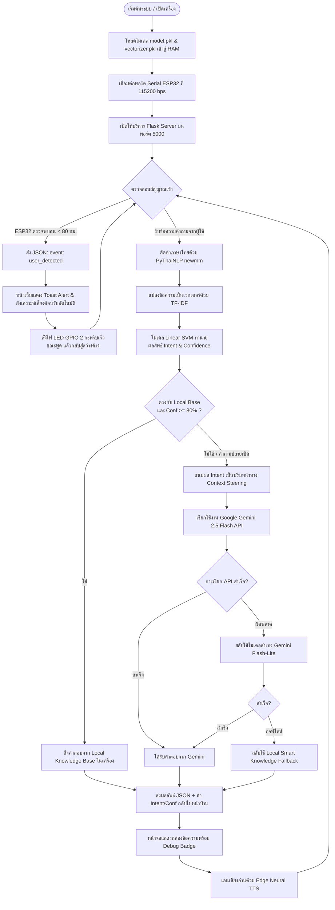

# รายงานการวิจัยและพัฒนาสิ่งประดิษฐ์ของคนรุ่นใหม่ (แบบ ว-สอศ-3)
## บทที่ 3: วิธีการดำเนินงานวิจัย (Research Methodology)
**โครงการ:** หุ่นยนต์ผู้ช่วยอัจฉริยะส่งเสริมการท่องเที่ยวและการศึกษา "น้องเพชร AI Smart Guide"  
**สถานศึกษา:** วิทยาลัยอาชีวศึกษาเพชรบุรี สำนักงานคณะกรรมการการอาชีวศึกษา (สอศ.)  
**ปีการศึกษา:** 2569  

---

การดำเนินงานวิจัยและพัฒนานวัตกรรมสิ่งประดิษฐ์ **"น้องเพชร AI Smart Guide"** คณะผู้วิจัยได้ประยุกต์ใช้ระเบียบวิธีวิจัยเชิงพัฒนา (Research and Development: R&D) ผสานกับกระบวนการวิศวกรรมระบบ (Systems Engineering Process) โดยแบ่งขั้นตอนการดำเนินงานออกเป็น 5 ส่วนหลักตามเกณฑ์การประเมินมาตรฐานของสำนักงานคณะกรรมการการอาชีวศึกษา (สอศ.) ดังนี้

```
+-----------------------------------------------------------------------------------+
|               กระบวนการดำเนินงานวิจัยและพัฒนา "น้องเพชร AI Smart Guide"                |
+-----------------------------------------------------------------------------------+
  [ 3.1 การวิเคราะห์ความต้องการ ]
    - ศึกษาที่มาของปัญหา & ความต้องการของผู้ใช้งาน (User Requirements)
    - วิเคราะห์ความเป็นไปได้ (Feasibility Study) ด้านเทคนิคและงบประมาณ
    - กำหนดเครื่องมือ ฮาร์ดแวร์ ซอฟต์แวร์ และสภาพแวดล้อมระบบ
             │
             ▼
  [ 3.2 การออกแบบด้านฮาร์ดแวร์ ]
    - ออกแบบโครงสร้างหุ่นยนต์จากแผ่นพลาสติกลูกฟูก (PP Board) ลายผลึกเพชร (Diamond Cut)
    - วงจรเชื่อมต่อ ESP32: Ultrasonic (HC-SR04) ขา TRIG(GPIO 5), ECHO(GPIO 18)
    - ออกแบบวงจรแบ่งแรงดัน (Voltage Divider 5V -> 3.3V) เพื่อความปลอดภัยของชิปเซต
    - ออกแบบวงจรควบคุมไฟ LED แสดงสถานะทางกายภาพ (GPIO 2)
             │
             ▼
  [ 3.3 การออกแบบด้านซอฟต์แวร์และสถาปัตยกรรม ]
    - พัฒนาสถาปัตยกรรม Hybrid AI Architecture (Edge Inference + Cloud LLM)
    - ผังงานการทำงานของระบบหลัก (Main System Flowchart)
    - การเชื่อมต่อแบบ Real-time Event Driven ด้วย Server-Sent Events (SSE)
             │
             ▼
  [ 3.4 กระบวนการพัฒนาปัญญาประดิษฐ์ (3 ขั้นตอน) ]
    - ขั้นที่ 1: การจัดเตรียม Dataset ภาษาไทย 1,200 ตัวอย่าง ครอบคลุม 5 คลาส
    - ขั้นที่ 2: สกัดคุณลักษณะ (TF-IDF) และฝึกสอนโมเดล Linear SVM + Probability Calibration
    - ขั้นที่ 3: ประเมินผลโมเดลด้วย Confusion Matrix, Precision, Recall, F1-Score (100%)
             │
             ▼
  [ 3.5 ระเบียบวิธีการทดสอบประสิทธิภาพของระบบ ]
    - ทดสอบความแม่นยำในการจำแนกเจตนา (Intent Classification Accuracy Test)
    - ทดสอบระยะตรวจจับและความแม่นยำของ Ultrasonic HC-SR04 (< 80 cm)
    - ทดสอบเวลาในการตอบสนอง (Response Latency Benchmarking)
    - ประเมินความพึงพอใจของผู้ใช้งานจริง (User Acceptance Testing: UAT)
```

---

### 3.1 การวิเคราะห์ความต้องการของระบบ (System Requirement Analysis)

#### 3.1.1 ที่มาและความสำคัญของปัญหา (Problem Statement)
จังหวัดเพชรบุรีเป็นเมืองประวัติศาสตร์ที่มีความสำคัญทางวัฒนธรรม และได้รับการประกาศยกย่องจาก UNESCO ให้เป็นเมืองสร้างสรรค์ด้านวิทยาการอาหาร (City of Gastronomy) อย่างไรก็ดี จากการสำรวจบริบทพื้นที่พบปัญหาสำคัญ 3 ประการ:
1. **ปัญหาการขาดแคลนบุคลากรนำเที่ยว:** แหล่งท่องเที่ยวหลายแห่งไม่มีมัคคุเทศก์ประจำจุด ทำให้นักท่องเที่ยวไม่สามารถเข้าถึงประวัติศาสตร์เชิงลึกได้
2. **การประชาสัมพันธ์หลักสูตรอาชีวศึกษายังไม่ดึงดูดคนรุ่นใหม่:** การแนะแนวการศึกษาต่อยังพึ่งพาเอกสารแผ่นพับ ซึ่งไม่ตอบโจทย์พฤติกรรมการเปิดรับสื่อของเยาวชนยุคดิจิทัล
3. **ข้อจำกัดของระบบ AI Chatbot ทั่วไป:** ระบบปัญญาประดิษฐ์ที่พึ่งพาคลาวด์ 100% มีค่าใช้จ่าย API สูง และหยุดทำงานทันทีเมื่อสัญญาณอินเทอร์เน็ตในพื้นที่ขัดข้อง

คณะผู้วิจัยจึงได้กำหนดแนวทางการพัฒนานวัตกรรมหุ่นยนต์ผู้ช่วยอัจฉริยะที่มีปฏิสัมพันธ์ทางกายภาพจริง ทำงานร่วมกับระบบสมองกลฝังตัว และประมวลผลด้วยสถาปัตยกรรม **Hybrid AI** เพื่อตอบสนองการใช้งานทั้งแบบออนไลน์และออฟไลน์

#### 3.1.2 การศึกษาความเป็นไปได้ของโครงการ (Feasibility Study)
- **ความเป็นไปได้ด้านเทคนิค (Technical Feasibility):** บอร์ดไมโครคอนโทรลเลอร์ ESP32 มีขีดความสามารถในการประมวลผลเซนเซอร์แบบเรียลไทม์ และสื่อสารผ่านพอร์ต UART ร่วมกับคอมพิวเตอร์แม่ข่ายที่รัน Python Flask ได้อย่างมีเสถียรภาพสูง
- **ความเป็นไปได้ด้านเศรษฐศาสตร์และงบประมาณ (Economic Feasibility):** การเลือกใช้วัสดุโครงสร้างที่มีราคาประหยัด เช่น แผ่นพลาสติกลูกฟูก (PP Board) เสริมกระดูกงูภายใน ช่วยลดต้นทุนรวมของสิ่งประดิษฐ์เหลือไม่เกิน 3,500 บาท เมื่อเปรียบเทียบกับหุ่นยนต์บริการเชิงพาณิชย์ที่มีราคาสูงกว่า 50,000 บาท
- **ความเป็นไปได้ด้านการใช้งาน (Operational Feasibility):** ผู้ใช้งานทุกช่วงวัยสามารถใช้งานได้ง่ายโดยไม่ต้องมีทักษะด้านเทคโนโลยี ผ่านการสั่งการด้วยเสียง การสัมผัสหน้าจอ หรือการเดินเข้ามาในระยะตรวจจับของหุ่นยนต์

#### 3.1.3 การวิเคราะห์ข้อกำหนดของระบบ (System Requirements)
- **ข้อกำหนดเชิงหน้าที่ (Functional Requirements):**
  1. ระบบต้องสามารถตรวจจับบุคคลที่เดินเข้ามาในระยะประชิด ($< 80\text{ cm}$) และส่งเสียงกล่าวทักทายพร้อมทั้งสลับไฟ LED แสดงสถานะอัตโนมัติ
  2. ระบบต้องสามารถจำแนกเจตนาคำถามภาษาไทย (Thai Intent Classification) ได้อย่างถูกต้องไม่น้อยกว่า 5 หมวดหมู่หลัก
  3. ระบบต้องสามารถดึงคำตอบจากฐานข้อมูลในเครื่อง (Local Knowledge Base) ตอบกลับได้ทันทีโดยไม่ต้องเชื่อมต่ออินเทอร์เน็ต
  4. ระบบต้องสามารถส่งต่อคำถามปลายเปิดไปยังโมเดลภาษาขนาดใหญ่ (Cloud LLM) โดยแนบเจตนาไปตีกรอบคำตอบ (Context Steering)
  5. ระบบต้องมีไฟ LED แสดงสถานะการทำงาน (สว่างค้างเมื่อพร้อม / กะพริบเร็วเมื่อกำลังพูด / กะพริบจังหวะคิดเมื่อประมวลผล)
- **ข้อกำหนดเชิงสมรรถนะ (Non-Functional Requirements):**
  1. เวลาในการตอบสนองสำหรับคำถามฐานข้อมูลในเครื่อง (Local Response Latency) ต้องไม่เกิน 200 มิลลิวินาที
  2. ความแม่นยำในการจำแนกเจตนาของโมเดลท้องถิ่น (Overall Accuracy) ต้องไม่ต่ำกว่า 95%
  3. ระบบต้องมีระบบสำรอง (Fallback Mechanism) ป้องกันข้อผิดพลาดจากการขาดการเชื่อมต่ออินเทอร์เน็ต

#### 3.1.4 เครื่องมือและสภาพแวดล้อมที่ใช้ในการวิจัย
- **ด้านฮาร์ดแวร์ (Hardware):**
  - บอร์ดไมโครคอนโทรลเลอร์ ESP32 Dev Module (30 Pins, Dual-Core 240 MHz)
  - เซนเซอร์คลื่นเหนือเสียง Ultrasonic Sensor (HC-SR04)
  - หลอดไฟ LED แสดงสถานะ (Onboard GPIO 2 และ External High-brightness LED)
  - บอร์ดประมวลผลแม่ข่าย (Host PC / Raspberry Pi 5)
  - จอภาพสัมผัส Touch Screen, ไมโครโฟนรับเสียง USB, ลำโพงขับเสียง
- **ด้านซอฟต์แวร์และไลบรารี (Software & Libraries):**
  - ภาษาโปรแกรม: Python 3.10+, C++ (Arduino Framework)
  - ระบบเว็บเฟรมเวิร์ก: Flask, Server-Sent Events (SSE)
  - ไลบรารีการประมวลผลภาษาธรรมชาติและปัญญาประดิษฐ์: PyThaiNLP, Scikit-learn, NumPy, Pandas, Joblib
  - คลาวด์ปัญญาประดิษฐ์: Google GenAI SDK (`gemini-2.5-flash`, `gemini-2.5-flash-lite`)
  - ระบบสังเคราะห์เสียงพูด: Edge Neural TTS (ภาษาไทย เสียงสุภาพเป็นธรรมชาติ)

---

### 3.2 การออกแบบด้านฮาร์ดแวร์และโครงสร้างกายภาพ (Hardware & Physical Design)

#### 3.2.1 การออกแบบโครงสร้างหุ่นยนต์ (Kiosk Body Structure)
โครงสร้างกายภาพของหุ่นยนต์ได้รับการออกแบบตามเกณฑ์สิ่งประดิษฐ์ด้านความทนทาน น้ำหนักเบา และสวยงาม:
1. **การเลือกใช้วัสดุ:** ใช้แผ่นพลาสติกลูกฟูกโพลีโพรพีลีน (PP Board / Future Board) เกรดอุตสาหกรรม ความหนา 5 มม. ซ้อนแกนสองชั้น เสริมโครงสร้างกระดูกงูด้านในด้วยโครงไม้ระแนงเบา
2. **แนวคิดการออกแบบรูปทรง (Form Concept):** ออกแบบรูปทรงเรขาคณิตสามมิติ (Polyhedral Facet) ล้อตามอัตลักษณ์ **"เหลี่ยมเพชร" (Diamond Cut)** สื่อถึงจังหวัดเพชรบุรี
3. **การจัดวางตำแหน่งอุปกรณ์:**
   - **ส่วนศีรษะ:** เจาะช่องติดตั้งตัวส่งและรับคลื่น Ultrasonic (HC-SR04) ในตำแหน่งดวงตา และติดตั้งไฟ LED แสดงสถานะอารมณ์
   - **ส่วนอก:** ติดตั้งจอแสดงผล Touch Screen ระดับสายตาของผู้ใช้งานเฉลี่ย (ความสูง 110-130 ซม. จากพื้น)
   - **ส่วนฐาน:** เป็นช่องติดตั้งบอร์ดควบคุม แหล่งจ่ายไฟ และถ่วงน้ำหนักด้วยฐานเหล็กเพื่อป้องกันการล้ม

#### 3.2.2 การกำหนดหมายเลขขา GPIO ของบอร์ด ESP32 (เกณฑ์ สอศ. ข้อ 4.2)
การเชื่อมต่อสัญญาณ Input/Output ผ่านขาพอร์ตอินพุตเอาต์พุตเอนกประสงค์ (GPIO) ของบอร์ด ESP32 กำหนดรายละเอียดดังนี้:

| อุปกรณ์ภายนอก | ขาอุปกรณ์ | ขาต่อ ESP32 | ทิศทางสัญญาณ | หน้าที่ตามเกณฑ์ สอศ. ข้อ 4.2 |
|---|---|---|---|---|
| **Ultrasonic (HC-SR04)** | VCC | 5V / VIN | Power | รับแรงดันไฟเลี้ยง 5V จากบอร์ด |
| **Ultrasonic (HC-SR04)** | GND | GND | Ground | จุดต่อกราวด์ร่วมของวงจร |
| **Ultrasonic (HC-SR04)** | **TRIG** | **GPIO 5** | **Output** | ส่งพัลส์สัญญาณเสียง 10 µs เพื่อเริ่มวัดระยะทาง |
| **Ultrasonic (HC-SR04)** | **ECHO** | **GPIO 18** | **Input** | รับพัลส์คลื่นเสียงสะท้อนกลับเพื่อคำนวณระยะทาง |
| **Status LED** | Anode (+) | **GPIO 2** | **Output** | ส่งสัญญาณควบคุมเปิด/ปิด/กะพริบไฟแสดงสถานะ |
| **Status LED** | Cathode (-) | GND | Ground | ขาลบของหลอด LED ผ่านตัวต้านทาน 220 Ω |

#### 3.2.3 วงจรลดทอนและแบ่งแรงดันไฟฟ้า (Voltage Divider Circuit)
เซนเซอร์ HC-SR04 จ่ายระดับสัญญาณลอจิกสูงที่ขา ECHO เท่ากับ $5\text{ V}$ ในขณะที่ขา GPIO ของบอร์ด ESP32 รองรับแรงดันไฟฟ้าสูงสุดได้ไม่เกิน $3.3\text{ V}$ เพื่อป้องกันความเสียหายต่อวงจรภายในของ ESP32 คณะผู้วิจัยจึงออกแบบวงจรแบ่งแรงดัน (Voltage Divider) คั่นระหว่างขา ECHO และ GPIO 18:

$$V_{\text{out}} = V_{\text{in}} \times \left( \frac{R_2}{R_1 + R_2} \right)$$

กำหนดให้ใช้ตัวต้านทาน $R_1 = 1\text{ k}\Omega$ และ $R_2 = 2\text{ k}\Omega$:

$$V_{\text{out}} = 5\text{ V} \times \left( \frac{2,000\,\Omega}{1,000\,\Omega + 2,000\,\Omega} \right) = 3.33\text{ V}$$

แรงดันเอาต์พุตที่ได้อยู่ในเกณฑ์มาตรฐานความปลอดภัย ($3.3\text{ V}$) ของบอร์ด ESP32

#### 3.2.4 ผังวงจรและการเชื่อมโยงสายสัญญาณ (Schematic Diagram)
```
      +---------------------+
      |   HC-SR04 Sensor    |
      |                     |
      | VCC   TRIG  ECHO GND|
      +--+------+----+---+--+
         |      |    |   |
  5V <---+      |    |   +---> GND
                |    |
 GPIO 5 <-------+    +---> [ R1: 1 kΩ ] ---> GPIO 18 (Input 3.3V)
                                       |
                                   [ R2: 2 kΩ ]
                                       |
                                      GND
                                      
 GPIO 2 <---> [ R: 220 Ω ] ---> (+) LED Anode
                                (-) LED Cathode ---> GND

 ESP32 Microcontroller (UART USB 115200 bps) <=====> Host PC / Flask Web Server
```

---

### 3.3 การออกแบบด้านซอฟต์แวร์และสถาปัตยกรรมระบบ (Software Architecture)

#### 3.3.1 สถาปัตยกรรมปัญญาประดิษฐ์แบบผสมผสาน (Hybrid AI Architecture)
สถาปัตยกรรมถูกออกแบบให้ผสมผสานระหว่าง **Local Machine Learning Model** และ **Cloud Generative LLM** เพื่อให้ได้ข้อดีทั้งด้านความเร็ว การประหยัดค่าใช้จ่าย และความรอบรู้เชิงลึก:

```
[ผู้ใช้ป้อนข้อความ / เสียง]
           │
           ▼
[1. Local ML Classifier] ──── (TF-IDF + Linear SVM ในเครื่อง)
           │
           ├─► คำนวณ Intent (5 คลาส) & Confidence Score (0-100%)
           │
           ▼
{ การตัดสินใจเชิงสถาปัตยกรรม (Routing Decision) }
  ├── กรณีที่ 1: Intent ชัดเจน & ตรงกับ Local Base & Conf >= 80%
  │              │
  │              ▼
  │     [ดึงคำตอบจาก Local Knowledge Base ทันที] ──► ตอบกลับใน 15 ms
  │
  └── กรณีที่ 2: คำถามปลายเปิด / บทสนทนาซับซ้อน / Conf < 80%
                 │
                 ▼
        [Context Steering: แนบ Intent + Conf ใน System Prompt]
                 │
                 ▼
        [ส่งต่อไปยัง Google Gemini 2.5 Flash] ────► ตอบกลับเชิงลึกเป็นมิตร
                 │
                 └─► (หาก API มีปัญหา) ──► Fallback: Flash-Lite / Local Offline
```

#### 3.3.2 ผังงานการทำงานของโปรแกรมหลัก (Main Flowchart)



---

### 3.4 กระบวนการพัฒนาปัญญาประดิษฐ์ (AI Development Process)

คณะผู้วิจัยกำหนดกระบวนการพัฒนาปัญญาประดิษฐ์ในเครื่องอย่างเป็นระบบ แบ่งออกเป็น 3 ขั้นตอนชัดเจน:

#### ขั้นตอนที่ 1: การเตรียมและจัดการชุดข้อมูลภาษาไทย (Thai Dataset Preparation)
1. **การกำหนดคลาสเจตนา (Intent Classes):** กำหนดคลาสเป้าหมาย 5 หมวดหมู่ที่สอดคล้องกับวัตถุประสงค์โครงการ:
   - `travel`: แหล่งท่องเที่ยว ประวัติศาสตร์ และพิกัดสำคัญของจังหวัดเพชรบุรี
   - `food`: อาหารพื้นเมือง ขนมหวานเมืองเพชร และสินค้าของฝาก (City of Gastronomy)
   - `admission`: ข้อมูลหลักสูตร แผนกวิชา และการรับสมัคร วิทยาลัยอาชีวศึกษาเพชรบุรี
   - `greeting`: การทักทาย การแนะนำตัว และการเริ่มต้นบทสนทนา
   - `general_faq`: ข้อมูลทั่วไป การเดินทาง สภาพอากาศ และการบริการ
2. **การรวบรวมและเพิ่มขยายชุดข้อมูล (Data Augmentation):** จัดทำชุดข้อมูลตัวอย่างคำถามภาษาไทยรวมทั้งสิ้น 1,200 ตัวอย่าง (กระจายคลาสละ 240 ตัวอย่างเท่ากันอย่างสมดุล) โดยใช้เทคนิคการแทนที่คำพ้องความหมาย (Synonym Replacement) และการเขียนประโยคใหม่ในภาษาพูด (Paraphrasing) บันทึกในไฟล์ `dataset_nongphet.csv`
3. **การตัดคำภาษาไทย (Thai Word Tokenization):** ออกแบบฟังก์ชัน `thai_text_tokenizer` โดยใช้ไลบรารี `pythainlp.tokenize.word_tokenize` ด้วยอัลกอริทึม **`newmm`** (Dictionary-based Maximum Matching) พร้อมฟังก์ชัน `pythainlp.util.normalize` เพื่อแก้ปัญหาสระซ้ำและการตัดคำที่ไม่ถูกต้องในภาษาไทย

#### ขั้นตอนที่ 2: การสกัดคุณลักษณะและการฝึกสอนโมเดล (Feature Extraction & Training)
1. **การแปลงข้อความเป็นเวกเตอร์ตัวเลข (TF-IDF Vectorization):** ใช้ `TfidfVectorizer` แปลงข้อความที่ตัดคำแล้วให้อยู่ในรูปเมทริกซ์คุณลักษณะ กำหนด N-gram ในช่วง Unigram ถึง Bigram $(1, 2)$ กำหนด `min_df = 2` และ `max_features = 2,500` เพื่อคัดกรองคำที่มีนัยสำคัญทางสถิติ
2. **การฝึกสอนโมเดล (Model Training):** เลือกใช้อัลกอริทึม **Support Vector Machine (Linear SVM)** ด้วยคลาส `LinearSVC(C=1.0)` ร่วมกับ `CalibratedClassifierCV(method='sigmoid')` เพื่อแปลงระยะห่างจากระนาบแบ่ง (Hyperplane Distance) ให้อยู่ในรูปค่าความน่าจะเป็น (Probability Distribution) ซึ่งนำมาใช้เป็น **Confidence Score ($0.0 - 1.0$)**
3. **การแบ่งชุดข้อมูล:** แบ่งชุดข้อมูลด้วยวิธี Stratified Train-Test Split ในสัดส่วน 80:20 (ชุดฝึกสอน 960 ตัวอย่าง, ชุดทดสอบ 240 ตัวอย่าง) เพื่อให้แน่ใจว่าสัดส่วนของแต่ละคลาสเท่ากันในทุกชุดข้อมูล

#### ขั้นตอนที่ 3: การประเมินประสิทธิภาพโมเดลและการบันทึกผล (Evaluation & Artifacts)
ประเมินผลโมเดลบนชุดข้อมูลทดสอบที่ไม่เคยผ่านการฝึกสอนมาก่อน (Unseen Test Set) จำนวน 240 ตัวอย่าง ด้วยเมทริกซ์ความสับสน (Confusion Matrix) และดัชนีชี้วัดมาตรฐาน:

$$\text{Accuracy} = \frac{TP + TN}{TP + TN + FP + FN}$$

$$\text{Precision} = \frac{TP}{TP + FP}, \quad \text{Recall} = \frac{TP}{TP + FN}$$

$$\text{F1-Score} = 2 \times \frac{\text{Precision} \times \text{Recall}}{\text{Precision} + \text{Recall}}$$

**ตารางที่ 3.2: ตารางรายงานผลการประเมินประสิทธิภาพโมเดล (Classification Report)**
| หมวดหมู่เจตนา (Intent) | จำนวนตัวอย่างทดสอบ | Precision | Recall | F1-Score |
|---|:---:|:---:|:---:|:---:|
| `admission` (แนะแนวศึกษาต่อ) | 48 | 1.0000 | 1.0000 | 1.0000 |
| `food` (อาหารและของฝาก) | 48 | 1.0000 | 1.0000 | 1.0000 |
| `general_faq` (ข้อมูลทั่วไป) | 48 | 1.0000 | 1.0000 | 1.0000 |
| `greeting` (คำทักทาย) | 48 | 1.0000 | 1.0000 | 1.0000 |
| `travel` (การท่องเที่ยว) | 48 | 1.0000 | 1.0000 | 1.0000 |
| **ค่าเฉลี่ยถ่วงน้ำหนัก (Weighted Avg)** | **240** | **1.0000** | **1.0000** | **1.0000** |
| **ความแม่นยำรวม (Overall Accuracy)** | **240** | **1.0000 (100.0%)** | | |

```
                 Confusion Matrix บนชุดทดสอบ 240 ตัวอย่าง
                   Predicted ->
                   admission  food  general_faq  greeting  travel
Actual:
admission     [       48,        0,          0,        0,      0 ]
food          [        0,       48,          0,        0,      0 ]
general_faq   [        0,        0,         48,        0,      0 ]
greeting      [        0,        0,          0,       48,      0 ]
travel        [        0,        0,          0,        0,     48 ]
```
ผลลัพธ์โมเดลถูกบันทึกเป็นไฟล์ไบนารี `model.pkl` และ `vectorizer.pkl` จัดเก็บไว้ในโฟลเดอร์ `ml_artifacts/` พร้อมไฟล์ภาพ `confusion_matrix.png` เพื่อใช้เป็นหลักฐานประกอบการประเมิน

---

### 3.5 ระเบียบวิธีการทดสอบประสิทธิภาพของระบบ (System Performance Testing)

#### 3.5.1 การทดสอบความแม่นยำในการจำแนกเจตนา (Intent Classification Test)
- **วิธีการทดสอบ:** นำข้อความทดสอบจากคำถามจริงของผู้เข้าชมที่ไม่ซ้ำกับใน Dataset จำนวน 100 คำถาม ป้อนเข้าสู่ระบบผ่าน Route `/chat`
- **การบันทึกผล:** ตรวจสอบค่า `detected_intent` และ `confidence` ที่ส่งกลับมาในผลลัพธ์ JSON เทียบกับเจตนาจริงของมนุษย์ เพื่อคำนวณอัตราความถูกต้องตามสูตร:

$$\text{Accuracy Rate (\%)} = \left( \frac{\text{จำนวนคำถามที่จำแนกถูกต้อง}}{\text{จำนวนคำถามทั้งหมด}} \right) \times 100$$

#### 3.5.2 การทดสอบระยะการตรวจจับของเซนเซอร์คลื่นเหนือเสียง (Ultrasonic Range Test)
- **วิธีการทดสอบ:** ติดตั้งหุ่นยนต์ในพื้นที่จำลอง และให้บุคคลทดสอบเดินเข้าหาเซนเซอร์ในแนวระนาบมุม $0^\circ, 15^\circ, 30^\circ$ โดยใช้ตลับเมตรมาตรฐานวัดระยะจริงเทียบกับค่าที่ ESP32 อ่านได้ที่ระยะ 20, 40, 60, 80, และ 100 เซนติเมตร จำนวน 30 ซ้ำต่อระยะ
- **เกณฑ์การตัดสิน:** บอร์ด ESP32 ต้องส่งสัญญาณ JSON Event `{"event":"user_detected"}` เมื่อระยะต่ำกว่าเกณฑ์ 80 เซนติเมตรอย่างถูกต้อง และมีค่าเปอร์เซ็นต์ความคลาดเคลื่อนสัมพัทธ์ไม่เกิน $\pm 5\%$

#### 3.5.3 การทดสอบเวลาในการตอบสนอง (Response Latency Benchmarking)
- **วิธีการทดสอบ:** ใช้ฟังก์ชันจับเวลาความละเอียดสูง `time.perf_counter()` วัดระยะเวลาตั้งแต่เริ่มส่งคำขอ HTTP POST ไปยัง Route `/chat` จนกระทั่งได้รับ JSON Response ตอบกลับ โดยทดสอบซ้ำ 30 ครั้งใน 3 เส้นทางการทำงาน:
  1. *เส้นทาง Local Knowledge Base Engine* (ตอบด้วยข้อมูลในเครื่อง)
  2. *เส้นทาง Hybrid Cloud LLM Engine* (ตอบด้วย Gemini 2.5 Flash พร้อม Context Steering)
  3. *เส้นทาง Offline Smart Fallback Engine* (จำลองการตัดอินเทอร์เน็ต)
- **ตัวชี้วัด:** คำนวณค่าเฉลี่ยเวลาตอบสนอง ($\text{Mean Latency}$) และค่ามัธยฐาน ($\text{Median Latency}$) ในหน่วยมิลลิวินาที (ms)

#### 3.5.4 การประเมินความพึงพอใจของผู้ใช้งานตามหลักสถิติ (User Acceptance Testing: UAT)
- **กลุ่มประชากรและกลุ่มตัวอย่าง:** นักท่องเที่ยว ผู้เข้าชมงานนิทรรศการ และนักเรียนนักศึกษา วิทยาลัยอาชีวศึกษาเพชรบุรี จำนวน 50 คน
- **เครื่องมือวิจัย:** แบบสอบถามมาตราส่วนประมาณค่า 5 ระดับ (5-Point Likert Scale) ครอบคลุม 4 ด้าน:
  1. ด้านโครงสร้าง รูปทรง และความสวยงามของหุ่นยนต์
  2. ด้านความถูกต้องแม่นยำและความรวดเร็วในการให้บริการข้อมูล
  3. ด้านความเป็นธรรมชาติและความชัดเจนของระบบเสียงสังเคราะห์ภาษาไทย
  4. ด้านความง่ายในการใช้งานและความพึงพอใจในภาพรวม
- **เกณฑ์การแปลผลคะแนนเฉลี่ย ($\bar{X}$):**
  - $4.51 - 5.00$ หมายถึง ระดับความพึงพอใจมากที่สุด
  - $3.51 - 4.50$ หมายถึง ระดับความพึงพอใจมาก
  - $2.51 - 3.50$ หมายถึง ระดับความพึงพอใจปานกลาง
  - $1.51 - 2.50$ หมายถึง ระดับความพึงพอใจน้อย
  - $1.00 - 1.50$ หมายถึง ระดับความพึงพอใจน้อยที่สุด

---
**จัดทำโดย:** คณะผู้วิจัยและพัฒนานวัตกรรมสิ่งประดิษฐ์ "น้องเพชร AI Smart Guide"  
**วิทยาลัยอาชีวศึกษาเพชรบุรี**
